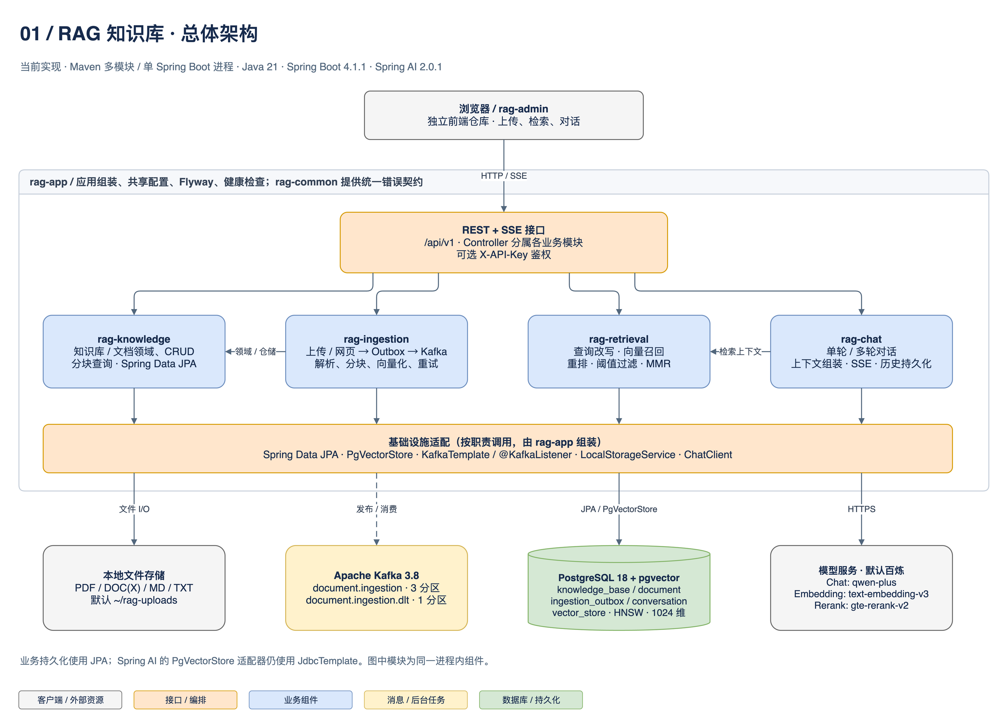
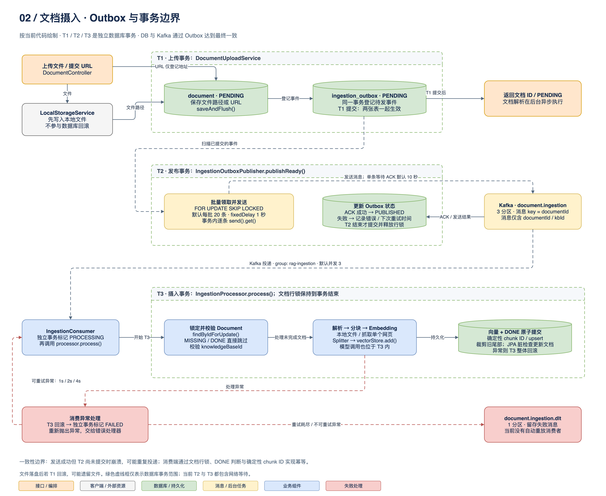
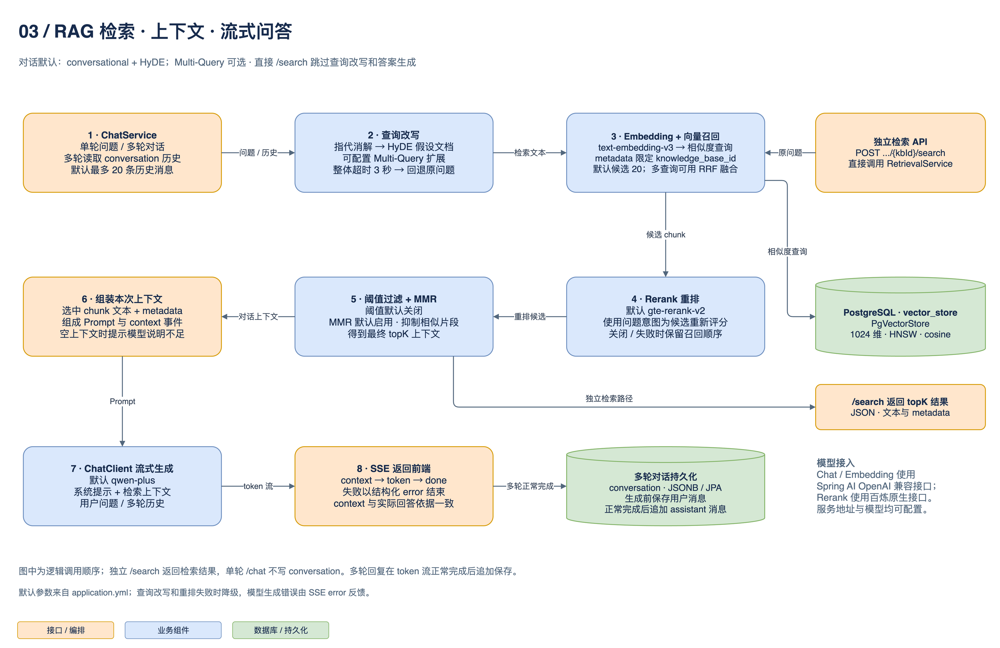

# RAG 架构图

依据 2026-09-17 仓库代码绘制。图中版本、模型与批次参数表示当前默认配置，不表示线上部署状态。

用 draw.io 打开 [rag-architecture.drawio](rag-architecture.drawio)，可编辑所有节点、文字和连接线，并在底部切换三页。

| 页面 | 内容 | 图片 |
|---|---|---|
| 01 总体架构 | 单进程中的业务模块、接口、存储、Kafka 与模型服务 | [PNG](rag-architecture-overview.png) |
| 02 摄入与事务 | 文件上传、Outbox 发布、消费处理的事务边界及失败重试 | [PNG](rag-ingestion-transactions.png) |
| 03 检索与问答 | 查询改写、向量召回、重排、MMR、SSE 与多轮历史 | [PNG](rag-retrieval-chat.png) |

PNG 也嵌入了 draw.io 数据；编辑后应重新导出图片，以保持预览与源文件一致。

## 总体架构

`rag-app` 将业务模块组装为同一个 Spring Boot 应用。基础设施适配层是职责概括，并非一个独立部署的服务；各模块按需使用其中的适配器。
业务持久化使用 Spring Data JPA；Spring AI `PgVectorStore` 的内部适配仍使用 `JdbcTemplate`。

## 摄入与事务

- **T1 上传事务**：`document` 与 `ingestion_outbox` 一起提交。文件写入虽然发生在上传方法内，但不参与数据库回滚。
- **T2 发布事务**：通过 `FOR UPDATE SKIP LOCKED` 领取事件，在事务中逐条等待 Kafka 确认，再记录成功或重试状态。行锁在事务结束时释放。
- **T3 摄入事务**：锁定文档，解析与调用 Embedding 模型，写入向量并更新 `DONE`；向量数据与文档状态一起提交。前置的 `PROCESSING` 和异常后的 `FAILED` 使用各自的事务。
- Outbox 提供最终一致和至少一次投递。发送成功、数据库尚未提交时的故障可能导致重复消息；消费者通过行锁、完成状态判断和确定性 chunk ID 保持幂等。
- DLT 留存重试耗尽或不可重试的失败消息；当前没有自动重放消费者。

## 检索与问答

对话默认启用 `conversational,hyde` 查询改写；`multi-query` 为可配置策略。查询改写失败回退原问题，重排失败保留召回顺序。
独立 `/search` 跳过改写与答案生成，返回最终检索结果。单轮 `/chat` 不写会话历史；多轮在生成前保存用户消息，在 token 流正常完成后追加 assistant 消息。

## 代码依据

图中业务节点带有 `data-provenance` 属性，记录对应仓库路径。主要来源：

| 关注点 | 来源 |
|---|---|
| 模块 / 依赖版本 | [pom.xml](../../../pom.xml)、[rag-app/pom.xml](../../../rag-app/pom.xml) |
| 当前默认参数 | [application.yml](../../../rag-app/src/main/resources/application.yml)、[docker-compose.yml](../../../docker-compose.yml) |
| 上传事务 | [DocumentUploadService](../../../rag-ingestion/src/main/java/com/majm/rag/ingestion/application/DocumentUploadService.java) |
| Outbox 领取与发布 | [IngestionOutboxRepository](../../../rag-ingestion/src/main/java/com/majm/rag/ingestion/infrastructure/persistence/IngestionOutboxRepository.java)、[IngestionOutboxPublisher](../../../rag-ingestion/src/main/java/com/majm/rag/ingestion/infrastructure/messaging/IngestionOutboxPublisher.java) |
| 消费 / 事务 / 重试 | [IngestionConsumer](../../../rag-ingestion/src/main/java/com/majm/rag/ingestion/infrastructure/messaging/IngestionConsumer.java)、[IngestionProcessor](../../../rag-ingestion/src/main/java/com/majm/rag/ingestion/application/IngestionProcessor.java)、[KafkaConfig](../../../rag-ingestion/src/main/java/com/majm/rag/ingestion/config/KafkaConfig.java) |
| 查询改写 / 检索 | [QueryRewriteService](../../../rag-retrieval/src/main/java/com/majm/rag/retrieval/rewrite/QueryRewriteService.java)、[RetrievalService](../../../rag-retrieval/src/main/java/com/majm/rag/retrieval/application/RetrievalService.java) |
| 对话 / SSE | [ChatService](../../../rag-chat/src/main/java/com/majm/rag/chat/application/ChatService.java)、[ChatSseEvents](../../../rag-chat/src/main/java/com/majm/rag/chat/api/ChatSseEvents.java) |
